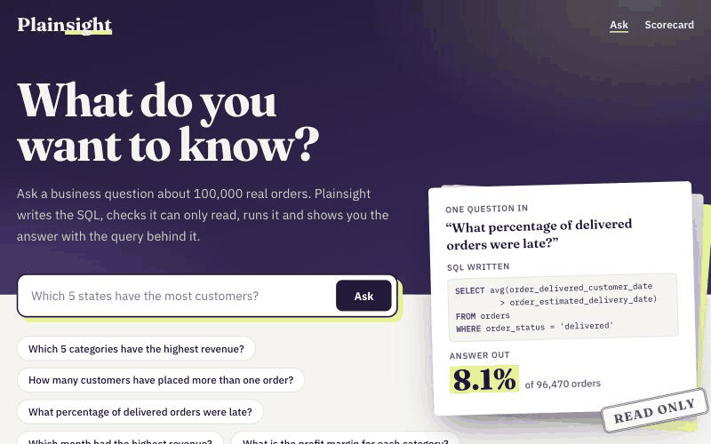
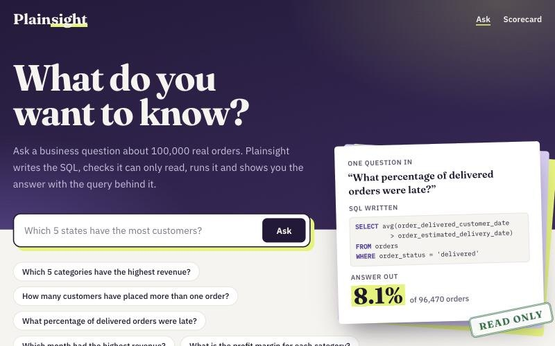
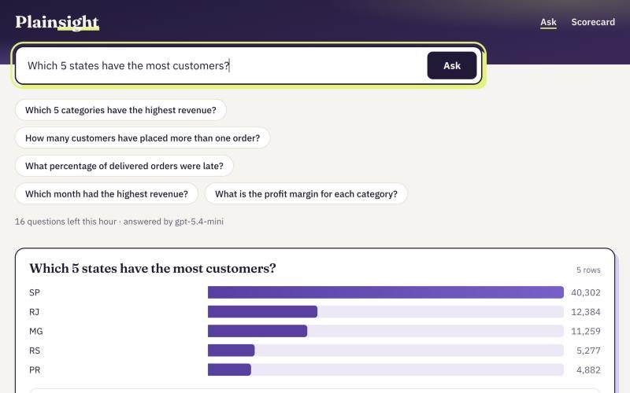
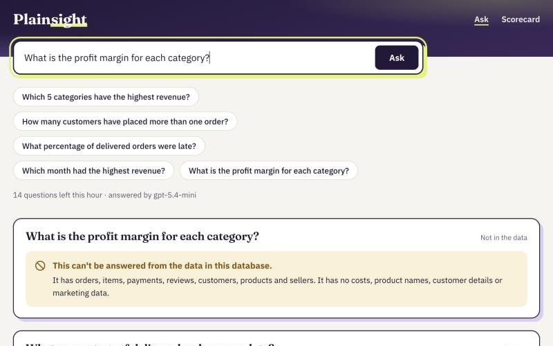
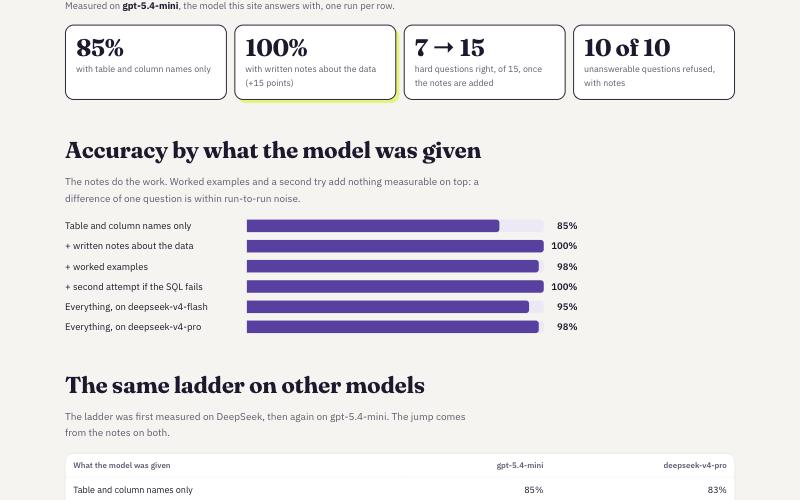
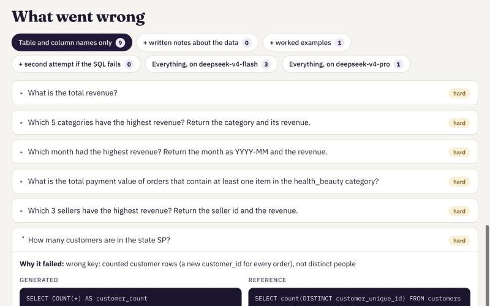
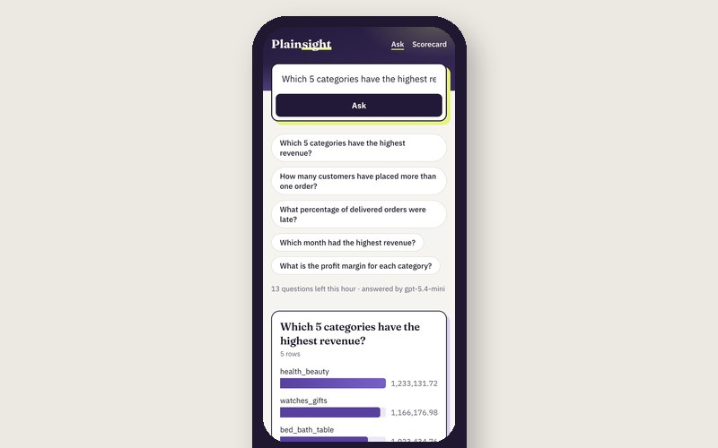
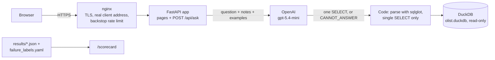
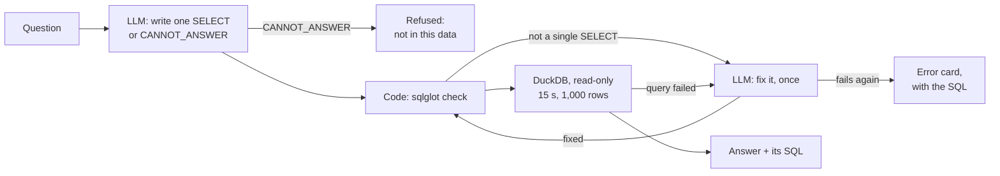

# Plainsight: plain English in, checked SQL and the answer out

Ask a business question about 100,000 real orders from a Brazilian online marketplace, like *"Which 5 categories have the highest revenue?"*, *"How many customers have placed more than one order?"* or *"What percentage of delivered orders were late?"*. Plainsight has a language model write one SQL query, checks in code that it can only read, runs it and shows you the answer with the query behind it. A benchmark of 60 questions with checked answers measures how often it's right, and what makes it right.

[](https://github.com/iyerbrah/Plainsight/actions/workflows/ci.yml)
[](https://github.com/iyerbrah/Plainsight/actions/workflows/deploy.yml)
[](https://plainsight.ramiyer.tech/)
[](LICENSE)
[](pyproject.toml)

**[Try the live demo →](https://plainsight.ramiyer.tech/)** · [Scorecard](https://plainsight.ramiyer.tech/scorecard) · Built by [Ram Iyer](https://github.com/iyerbrah)



## Highlights

- **The finding: the notes do the work.** Given only the table and column names, gpt-5.4-mini answers 85% of the 60 test questions right, and 7 of the 15 hard ones. Given one page of written notes on what the data means (what counts as revenue, which id is a customer), it answers 100%. Worked examples and a second attempt add nothing measurable. DeepSeek V4 Pro, tested first, shows the same jump: 83% to 98%.
- **The model writes SQL; code decides what runs.** Every query is parsed with sqlglot and anything but a single `SELECT` is refused before it reaches the database. The database is opened read-only, can't read files or web addresses, and stops at 15 seconds or 1,000 rows.
- **It refuses instead of guessing.** Questions the data can't answer (profit margins, costs, customer names) come back as "can't be answered from this data", not as a confident wrong number. With the notes, all 10 such test questions are refused.
- **Every answer shows its receipt.** The SQL is always on screen, with a copy button. Results are drawn as one big number, or a bar chart and the rows.
- **Measured in public.** The [Scorecard](https://plainsight.ramiyer.tech/scorecard) shows every run and every failure, with the generated and reference SQL side by side and the reason it failed. Every result file is committed in [results/](results/).
- **Shipped like a team.** Small PRs with CI on each one (104 offline tests with a fake model), a protected `main`, and automatic deploys to its own Ubuntu server behind nginx with HTTPS. Per-visitor and daily question limits keep the bill at about $0.0015 a question.

**Stack:** Python 3.12 · FastAPI · Jinja2 + vanilla JS · DuckDB · sqlglot · OpenAI `gpt-5.4-mini` · pytest · ruff · GitHub Actions · nginx + systemd on an Ubuntu VPS

| Ask in plain English | Get the answer and its SQL | Refused when the data can't answer |
| --- | --- | --- |
|  |  |  |

| How often it's right | Every failure, explained | Works on a phone |
| --- | --- | --- |
|  |  |  |

## Why I built it

Tools that let people ask data questions in plain English are easy to demo and hard to trust: a wrong number looks exactly like a right one. I wanted to measure how often the answers are right, and find out what actually makes them right.

## Architecture



- **`POST /api/ask`** takes one question (up to 300 characters) and returns the answer, the SQL and how to draw it.
- **`GET /`** and **`GET /scorecard`** are the two pages, rendered on the server; a little plain JavaScript asks questions and draws the answers.
- **`GET /healthz`** checks the app can open its database, without calling the model; systemd, the deploy script and uptime monitors use it.
- **Limits:** 20 questions an hour per visitor and 300 a day for the whole site, counted in the app; nginx adds a looser per-address cap as a backstop. The same question is answered from a cache instead of asking the model again.

## How an answer is made

1. **Build the prompt.** The question goes to the model with [schema.md](schema.md), a page of written notes about the tables and their traps, and six worked examples from [examples.yaml](examples.yaml). The instructions: reply with exactly one `SELECT`, or `CANNOT_ANSWER` if the data can't answer it.
2. **The model writes the query** (1 call, reasoning effort `low`).
3. **Code checks it.** sqlglot parses it, and anything other than a single `SELECT` (or `UNION` of selects) is refused.
4. **It runs read-only** in DuckDB, with external access off, a 15-second timeout and a 1,000-row cap.
5. **One second try.** If the query fails, the error goes back to the model once for a fix. The page says when the answer came from the corrected query.
6. **Show it.** One value is shown large; a label and a number per row get a bar chart above the table; anything else is a table. The SQL is always shown.



## The data

The public [Olist dataset](https://www.kaggle.com/datasets/olistbr/brazilian-ecommerce): orders placed on a Brazilian marketplace between September 2016 and October 2018, money in Brazilian reais, in eight tables. The file is in the repository (`olist.duckdb`, 27 MB), so the app runs without the download.

| Table | Rows | One row per |
| --- | --- | --- |
| `orders` | 99,441 | order |
| `order_items` | 112,650 | item in an order |
| `order_payments` | 103,886 | payment on an order |
| `order_reviews` | 99,224 | review |
| `customers` | 99,441 | order's customer record |
| `products` | 32,951 | product |
| `sellers` | 3,095 | seller |
| `product_category_name_translation` | 71 | category |

The hard part is the business meaning, not the SQL. `customer_id` is new for every order, so counting repeat customers with it always gives zero; revenue means item prices on delivered orders, not payments; joining items and payments at the same level multiplies rows. [schema.md](schema.md) spells these out, and that page is what the benchmark measures.

## Key decisions

- **Notes over examples.** The benchmark ladder adds one thing at a time, and the written notes are the only addition that moved the score. They're also cheaper to keep right than a pile of examples, and the examples caused a mistake of their own (see below).
- **Code is the safety boundary, not the prompt.** The model is asked for one `SELECT`, but nothing relies on it: the parser, the read-only connection, the timeout and the row cap hold even if the model writes something else.
- **Refusing is a valid answer.** `CANNOT_ANSWER` is part of the contract, scored as correct for the 10 questions the data can't answer and as wrong anywhere else.
- **Scored on results, not SQL text.** Two different queries can both be right, so a generated query is correct when it returns the same table as the checked reference: row order, column order and column names don't matter, and extra columns are allowed.
- **One small app.** FastAPI with server-rendered pages and no frontend framework, a database file in the repository, and one process on its own server. The limits are counted in memory, which is why the service runs a single worker.

## Evaluation

[benchmark.yaml](benchmark.yaml) has 60 questions, each with a reference query whose answer was checked against the database. [evaluate.py](evaluate.py) asks the real model each question under each setup and scores the results.

| Difficulty | Questions | Example |
|---|---|---|
| Easy | 15 | How many orders were canceled? |
| Medium | 20 | Which 5 customer states placed the most orders? |
| Hard | 15 | How many customers have placed more than one order? |
| Cannot be answered | 10 | What is the profit margin for each category? |

Each row adds one thing to the row above it, to show what that addition is worth. gpt-5.4-mini ran with reasoning effort `low`, as on the site.

| What the model was given | gpt-5.4-mini | Hard questions | DeepSeek V4 Pro |
|---|---|---|---|
| Table and column names only | 51 of 60 (85%) | 7 of 15 | 50 of 60 (83%) |
| + written notes about the data | **60 of 60 (100%)** | 15 of 15 | 59 of 60 (98%) |
| + six worked examples | 59 of 60 (98%) | 15 of 15 | 58 of 60 (97%) |
| + a second attempt if the SQL fails | 60 of 60 (100%) | 15 of 15 | 59 of 60 (98%) |

DeepSeek V4 Flash, a model costing a fifth as much as V4 Pro, got 57 of 60 (95%) with everything.

What this shows:

- **The written notes do the work.** Without them, gpt-5.4-mini gets 8 of the 15 hard questions wrong. Seven are a missing business rule: what counts as revenue, which orders count, and the customer id that is new for every order. The eighth is a query that referred to a table it never named. With the notes, all 15 are right.
- **Worked examples and the second attempt added nothing measurable.** Those rows differ by one question, which is within the variation between runs. The second attempt was never needed: with the notes, no generated query failed to run.
- **The examples caused a new mistake.** One example filters revenue to delivered orders. After seeing it, every model added that filter to a question that did not ask for it. All three errors of DeepSeek V4 Flash are this one mistake.
- **The "cannot be answered" questions are nearly too easy.** With the notes, all 10 were refused on every model. Without them, gpt-5.4-mini answered one: it called item prices the cost of goods sold.

**Cost:** the four gpt-5.4-mini runs (240 questions) cost about $0.29 at OpenAI's list price of $0.75 per million input tokens and $4.50 per million output tokens; the five DeepSeek runs about $0.09 together. On the site, one question costs about $0.0015, so a day at the 300-question cap costs under $0.50.

## Known limitations

- **One run per row,** so a difference of one or two questions means nothing, and a perfect score on 60 questions doesn't mean the next question will be answered right.
- **60 questions on one database** is a small test.
- **The notes and the questions were written together,** so the hard questions measure whether the model follows stated rules, not whether it could work them out alone.
- **Scoring is lenient:** a result with extra columns still counts as correct.
- **The data stops in 2018** and never changes; questions about anything later get no rows.
- **It's a demo:** the question limits and the answer cache live in memory, so a restart clears them.

## Repository tour

| Path | What's there |
| --- | --- |
| [`engine.py`](engine.py) | Question to answer: builds the prompt, calls the model, checks the SQL, runs it read-only, the one retry |
| [`schema.md`](schema.md), [`examples.yaml`](examples.yaml) | The written notes about the data and the six worked examples, both sent to the model |
| [`web/main.py`](web/main.py) | The routes: the two pages, `POST /api/ask`, `/healthz`, the answer cache |
| [`web/templates/`](web/templates/), [`web/static/`](web/static/) | The pages, the stylesheet and the JavaScript that asks questions and draws answers |
| [`web/scores.py`](web/scores.py) | Reads the result files for the Scorecard |
| [`limits.py`](limits.py) | Questions per visitor per hour, and per day for the whole site |
| [`benchmark.yaml`](benchmark.yaml), [`evaluate.py`](evaluate.py) | The 60 test questions with reference SQL, and the runner that scores a setup |
| [`results/`](results/), [`failure_labels.yaml`](failure_labels.yaml) | Every question, generated query and outcome for each run, and the reason for each failure |
| [`tests/`](tests/) | 104 offline tests with a fake model: SQL safety, scoring, every reference query, limits, the website |
| [`deploy/`](deploy/) | The systemd unit, nginx site, deploy scripts and the server runbook |
| [`.github/workflows/`](.github/workflows/) | CI on every PR, and the deploy after CI passes on `main` |
| [`build_db.py`](build_db.py) | Loads the Kaggle CSVs into `olist.duckdb` |

## Run locally

You need Python 3.11 or newer and an OpenAI API key.

```bash
python3 -m venv .venv
.venv/bin/pip install -r requirements-dev.txt
cp .env.example .env                                  # then add OPENAI_API_KEY
.venv/bin/uvicorn web.main:app --reload --port 8100   # http://127.0.0.1:8100
```

`.env` is ignored by git, so the key never gets committed; restart the app after changing it.

```bash
.venv/bin/pytest -q                                   # all tests, no key needed: the model is faked
.venv/bin/python evaluate.py --setup all              # the whole benchmark ladder (about $0.30)
.venv/bin/python evaluate.py --setup names_only       # one setup
```

To rebuild the database from the source, download the Olist dataset from Kaggle, unzip the CSVs into `data/` and run `.venv/bin/python build_db.py`.

## Deploy

The live site, [plainsight.ramiyer.tech](https://plainsight.ramiyer.tech), runs on an Ubuntu VPS shared with two other projects: nginx with a Let's Encrypt certificate in front, the app under uvicorn as a locked-down systemd service. Merging into `main` deploys automatically once CI passes: GitHub Actions connects with a key that can run only the deploy script, which accepts only commits on `main`, and checks the site answers. [deploy/README.md](deploy/README.md) has the day-to-day commands, rollback, the setup from scratch and troubleshooting.

## License

The code is under the [MIT license](LICENSE). The data is Olist's public dataset, published on [Kaggle](https://www.kaggle.com/datasets/olistbr/brazilian-ecommerce) under the terms shown there. Plainsight is a portfolio demo: answers are written by a language model, so check the SQL before relying on one.
